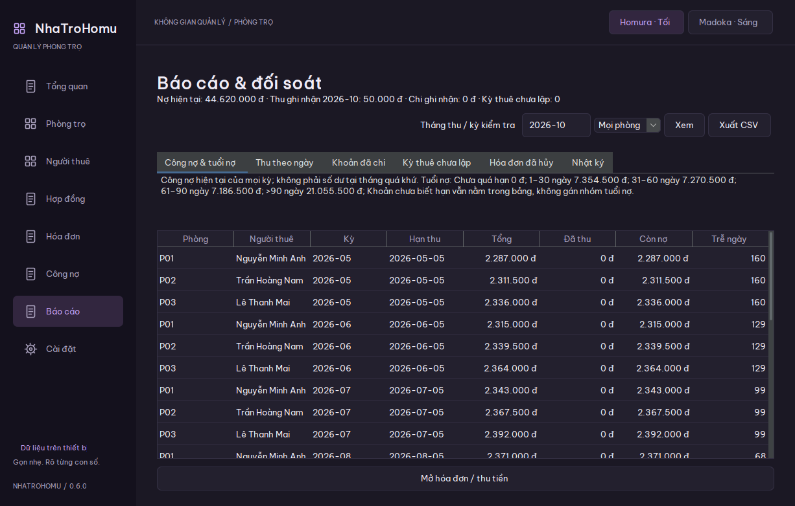

# NhaTroHomu

Ứng dụng Windows quản lý phòng trọ trên máy cá nhân, xây dựng bằng **Java 21, Swing, FlatLaf, JDBC và SQLite**. Đọc ảnh đồng hồ điện/nước bằng OCR Windows hoặc gói RapidOCR tùy chọn, cho người dùng kiểm tra và sửa chỉ số trước khi lập hóa đơn.

Phiên bản **0.8.4**. Phạm vi hiện tại: một người quản lý, một sổ dữ liệu local. Không cần server để sử dụng.

Hướng dẫn nghiệp vụ: [Phòng, hợp đồng, các trường ngày/cọc/phí và giới hạn sửa hóa đơn, trả trước](docs/phong-hop-dong-va-thanh-toan.md). Giá thuê đặt ở Hợp đồng; thẻ phòng ghi rõ giá hiện tại hoặc tiền của kỳ lịch sử. Thẻ có chiều cao riêng, bấm Xem đầy đủ / Thu gọn để mở và đóng nội dung; đổi bảng/thẻ trở về đầu danh sách.

Màn Hóa đơn mặc định mở tháng mới nhất, có bộ chọn tháng và nút Lập hóa đơn trực tiếp. CSV xuất theo toàn bộ phạm vi tháng được chọn, không chỉ trang đang thấy. Nút Cho thuê phòng cho phép chọn hoặc thêm người thuê ngay trong form, giữ thông tin thỏa thuận khi mở hồ sơ mới; không cần chuyển trang để tạo người thuê trước.



[Tổng quan](docs/assets/dashboard.png) · [Giao diện sáng](docs/assets/rooms-light.png).

## Chạy thử

Giải nén toàn bộ `NhaTroHomu-0.8.4-windows-x64.zip`, mở `NhaTroHomu.exe`. Bản portable đã có Java; giữ nguyên các thư mục đi kèm.

`Mo-ban-demo.cmd` mở sổ minh họa riêng với phòng, hợp đồng, hóa đơn và thu tiền từng phần. Dữ liệu demo không được ghi vào sổ thật.

## Tính năng

- Quản lý phòng, người thuê, hợp đồng, giá thuê, hạn thu và phí định kỳ.
- Lập hóa đơn tiền phòng, điện, nước và phí; lưu giá, tên, chỉ số và ảnh tại lúc chốt.
- OCR trên máy, chọn/cắt ảnh, chọn kết quả hoặc nhập tay và xác nhận lại.
- Nước theo đồng hồ hoặc mức m³ khoán chung/riêng. Chuyển cách tính tại ranh giới kỳ có số bàn giao.
- Thu tiền từng phần, công nợ và tuổi nợ; phân biệt kỳ hóa đơn với ngày thu.
- Ghi khoản đã chi theo loại, phòng, người nhận và phương thức; xem thu trừ chi theo tháng.
- Nhận/hoàn cọc riêng với tiền hóa đơn.
- Hủy hóa đơn cuối và đảo khoản thu/chi nhập nhầm có lịch sử; giữ chứng từ gốc.
- Báo cáo kỳ thuê chưa lập hóa đơn, hóa đơn đã hủy, nhật ký, bảng chi tiết và xuất CSV.
- Xuất PDF tiếng Việt, TXT; sao lưu và kiểm tra bản phục hồi trước khi thay sổ đang dùng.
- Theme Homura tối và Madoka sáng.

## Quy trình sử dụng

1. Đặt đơn giá, thêm phòng và chỉ số ban đầu.
2. Thêm người thuê, tạo hợp đồng và các khoản phí. Phí nhập mỗi dòng như `Internet=100000`.
3. Ghi nhận tiền cọc thực nhận; mức cọc hợp đồng không tự tạo một lần nhận tiền.
4. Lập hóa đơn từ kỳ vào ở, chốt tuần tự từng tháng; kiểm tra ảnh, chỉ số, tiền phòng và phí.
5. Ghi từng lần thu tiền. Vào **Báo cáo** để xem công nợ mọi kỳ, thu theo ngày và các kỳ thuê còn thiếu.
6. Ghi khoản đã chi trong **Báo cáo → Khoản đã chi**.
7. Khi kết thúc thuê, ghi ngày kết thúc và xử lý nợ/cọc còn lại. Sao lưu ra vị trí khác định kỳ.

Tiền thuê/cọc/phí/thu/chi là số nguyên đồng. Chỉ số hỗ trợ tối đa ba chữ số thập phân. Ngày dùng `YYYY-MM-DD`, kỳ dùng `YYYY-MM`.

**Đảo khoản nhập nhầm không phải hoàn tiền thật.** Chỉ dùng khi bản ghi trước không phản ánh giao dịch đúng; bản hiện tại chưa có luồng hoàn tiền thuê hoặc bù trừ cọc vào nợ.

## Định nghĩa báo cáo

- **Tổng quan theo kỳ:** khoản đã lập hóa đơn và mọi lần thu còn hiệu lực cho hóa đơn kỳ đó, kể cả thu tháng khác.
- **Thu theo ngày:** khoản thu ghi nhận trong tháng chọn, trừ khoản nhập nhầm được đảo trong tháng đó; cọc tách riêng.
- **Công nợ/tuổi nợ:** số dư hiện tại của mọi kỳ. Chọn tháng quá khứ không biến bảng này thành báo cáo số dư tại ngày quá khứ.
- **Khoản đã chi:** các khoản đã trả, trừ đảo nhập nhầm theo ngày đảo. Thu trừ chi chưa gồm nhận/hoàn cọc và không phải lợi nhuận kế toán.
- **Kỳ thuê chưa lập:** nghĩa vụ theo tháng của hợp đồng đến kỳ chọn; phòng trống không tự tạo nợ thuê.
- **Nhật ký:** 500 thay đổi gần nhất toàn sổ, độc lập bộ lọc phòng/tháng.

## Giới hạn nghiệp vụ

- Một hợp đồng/phòng/tháng; chưa đổi khách giữa tháng hoặc tách hóa đơn theo ngày bàn giao.
- Tiền thuê/phí mặc định cả tháng. Ở chưa đủ tháng cần chỉnh tiền phòng với lý do; chưa tự chia tiền theo ngày.
- Chưa thay/reset đồng hồ, chuyển cách tính nước giữa tháng hoặc phân chia đồng hồ tổng.
- Đơn giá hiện hành được chụp vào hóa đơn; chưa có lịch giá tự chọn theo kỳ cũ. Kiểm tra giá trước khi lập bổ sung dữ liệu lịch sử.
- Mỗi lần thu gắn một hóa đơn; chưa nhận trước, phân bổ một khoản thu cho nhiều hóa đơn, giảm trừ hoặc hoàn tiền thuê.
- Cọc chưa bù trừ nợ, chưa có quy trình quyết toán trả phòng tự động.
- Dữ liệu cũ đã bỏ tháng được báo để đối soát; chưa có luồng tự sửa chuỗi kỳ đã chốt.
- Chưa multiuser, đồng bộ nhiều máy, sao lưu tự động, installer ký mã hay tự cập nhật.

## Phát triển

JDK 21+ trên PATH. Windows 10/11 x64 cho giao diện và OCR; lần build đầu cần mạng để tải thư viện cố định từ Maven Central. `run.ps1` kiểm tra SHA-256 của thư viện theo `dependencies.sha256`.

```powershell
powershell -NoProfile -ExecutionPolicy Bypass -File .\run.ps1 -Demo
powershell -NoProfile -ExecutionPolicy Bypass -File .\run.ps1 -Test
powershell -NoProfile -ExecutionPolicy Bypass -File .\run.ps1 -Smoke
powershell -NoProfile -ExecutionPolicy Bypass -File .\package.ps1
```

Nếu đã cài Maven: `mvn test` chạy cùng bộ kiểm tra hồi quy thông qua `AllChecks`. Trong môi trường headless, bộ kiểm tra Swing được bỏ qua và ghi rõ `SKIP`; OCR tích hợp cần gói OCR của Windows và chạy riêng.

Kiểm tra bao gồm tính tiền, hợp đồng/cọc, thu từng phần, snapshot, migration, PDF, backup/restore, dữ liệu không hợp lệ, thu đồng thời, đổi nước, báo cáo, chi phí và CSV. Các kiểm tra dùng sổ tạm. CI Windows được cấu hình trong `.github/workflows/windows.yml`; trạng thái CI chỉ được xác nhận khi workflow chạy trên GitHub.

Đóng gói tạo `release/v0.8.4/NhaTroHomu/NhaTroHomu.exe` và ZIP đi kèm runtime. Script không ghi đè thư mục phát hành đã có. `-Installer` cần WiX 3. Heap đặt tối đa 256 MB; đây không phải số đo tổng RAM của tiến trình.

## Dữ liệu và an toàn

Sổ mới dùng `%LOCALAPPDATA%\NhaTroHomu\nhatrohomu.db`; demo dùng `NhaTroHomu-demo`. Khi tìm thấy sổ Sổ Trọ cũ, ứng dụng sử dụng lại thư mục/file cũ và cùng khóa `app.lock`. Đóng bản cũ trước khi mở bản mới. Có thể chỉ định thư mục bằng `-Dnhatrohomu.data=...` khi chạy Java.

Schema 6 có backup trước nâng cấp. Bản cũ không mở được schema mới. Phục hồi kiểm tra cấu trúc, tham chiếu và số liệu trên bản ứng viên, giữ bản cứu hộ rồi mới thay dữ liệu; chờ các connection đang dùng đóng.

DB, backup, ảnh và tài liệu xuất **chưa mã hóa**. Không có đăng nhập/phân quyền. Nhật ký/trigger bảo vệ lịch sử qua luồng SQL thông thường, không chống người có quyền sửa file hoặc thay ứng dụng trên máy. Không chia sẻ database qua ổ mạng và không đưa sổ/ảnh khách thật vào GitHub.

[Kiến trúc và schema](docs/architecture.md) · [Phạm vi bảo mật](docs/security.md) · [Đóng góp](CONTRIBUTING.md) · [Thay đổi](CHANGELOG.md).

## Lịch sử điện nước và hồ sơ

Ở **Phòng trọ → Lịch sử điện nước**, chọn khoảng kỳ YYYY-MM hoặc **Tất cả kỳ**. Mỗi dòng có chỉ số cũ/mới, lượng điện/nước dùng, tiền điện, tiền nước, cộng điện nước, tiền phòng, phí và tổng hóa đơn. Chọn dòng để xem/xuất PDF hoặc TXT; CSV xuất đúng khoảng đã xem. CSV ở trang Hóa đơn xuất toàn bộ. Nước khoán không có chỉ số đồng hồ cũ/mới; cột đó để trống trong CSV. Chỉ các kỳ đã chốt có dữ liệu, không tự suy ra số cho tháng chưa lập hóa đơn. Đơn giá và số tiền là bản chốt của kỳ đó.

**Người thuê → Hồ sơ / người ở cùng** có số điện thoại, Zalo, CCCD/giấy tờ, ngày sinh, địa chỉ và tab gia đình. Zalo tự điền theo điện thoại khi bật tùy chọn; tắt tùy chọn để sửa riêng hoặc để trống. Đây là số liên hệ nhập tay, không xác minh tài khoản Zalo hay CCCD. Danh sách gia đình là hồ sơ hiện tại, chưa quản lý ngày vào/ra hay lịch sử cư trú theo hợp đồng. Tránh nhập giấy tờ khi không cần; dữ liệu local và backup chưa mã hóa.

Hợp đồng ghi thỏa thuận thuê, thời hạn, tiền phòng/phí/cọc. Hóa đơn chốt khoản phải trả của từng kỳ. Công nợ = tổng hóa đơn − tiền đã thu; không cộng cọc vào tiền thu hóa đơn. Báo cáo tổng hợp công nợ, thu/chi, kỳ chưa lập và chứng từ hủy để đối soát; dòng tiền không đồng nghĩa lợi nhuận.

Các khoản điện/nước trong CSV giữ độ chính xác thập phân; tổng hóa đơn được làm tròn đến đồng một lần theo chính sách hiện có.

## Giấy phép

Source MIT. Font, thư viện và runtime giữ giấy phép riêng trong [THIRD-PARTY-NOTICES.md](THIRD-PARTY-NOTICES.md).

## Thao tác với danh sách

Chọn dòng để hiện nút thao tác; chuột phải trên dòng để mở cùng menu. Nhấp đúp hoặc Enter mở hồ sơ/chi tiết/thu tiền tùy trang. Các thao tác đảo chứng từ không chạy bằng nhấp đúp. Sau khi lưu, danh sách tự tải lại; biểu tượng mũi tên vòng chỉ dùng khi muốn kiểm tra lại. Báo cáo giữ tab khi cập nhật và tự tải khi đổi phòng. Chuột phải trên thẻ phòng mở tùy chọn phòng.

## Hóa đơn lịch sử nhập từ sổ cũ

Schema 6 giữ tiền phòng lịch sử mà không dựng hợp đồng/người thuê chưa được cung cấp. Thành tiền nước gốc có thể khác lượng × giá; `water_amount` lưu riêng số tiền gốc, không đổi chỉ số hay đơn giá. Chỉ chứng từ có nhật ký IMPORT được phép dùng ngoại lệ này; hóa đơn thường vẫn bắt buộc tính đúng theo hợp đồng và đơn giá. Các số liệu khác biệt được ghi chú cần đối soát. Trạng thái đã thu cần chủ sổ xác nhận; nếu thiếu ngày nhận tiền thì để trống, báo cáo không tự gán vào ngày nhập. Khoản nợ chuyển kỳ không cộng hai lần. Nguồn Excel và dữ liệu thật giữ local, không nằm trong repo/bản phát hành.

## Cách xem, ngày tháng và liên kết

Danh sách có lựa chọn Thẻ / Bảng và nhớ cách xem trên máy; lọc, sắp xếp, thao tác và dữ liệu dùng chung. Thẻ có Xem đầy đủ để mở các trường phụ và Xem thêm khi danh sách dài. Dùng nút lịch bên ô ngày/kỳ hoặc nhập ISO như trước. Thanh Homura / Madoka đổi giao diện tối/sáng.

Người thuê có cột phòng hiện tại/sắp thuê. Chọn Phòng / hợp đồng / hóa đơn để mở các liên kết qua ID hợp đồng và công nợ từng hóa đơn. Gắn phòng tạo hợp đồng với người thuê đã chọn; không gán theo tên giống nhau. Hóa đơn Excel chưa có tên/hợp đồng vẫn giữ độc lập, không tự gán sang người mới.

OCR mặc định dùng Windows.Media.Ocr. Có thể cài **RapidOCR4j 1.0.3 / PP-OCRv4 / ONNX Runtime CPU** bằng `powershell -ExecutionPolicy Bypass -File .\install-ocr.ps1`, chạy trong thư mục source hoặc thư mục chứa EXE. Cài cho bản portable từ source: thêm `-AppDirectory "đường dẫn thư mục chứa NhaTroHomu.exe"`. Script tải ba JAR cố định từ Maven Central và kiểm tra SHA-256; cần mạng một lần, khoảng **198 MB** tải thêm. Model có sẵn trong JAR, lúc nhận diện không gửi ảnh ra mạng và không cần Python/GPU. Gói này không nằm trong ZIP bản thường. Xóa riêng thư mục `app/ocr` (portable) hoặc `lib/ocr` (source) nếu muốn gỡ gói; dữ liệu sổ nằm riêng.

Sau khi cài, mở lại màn hình lập hóa đơn và chọn engine cạnh nút nhận diện. RapidOCR chạy trong tiến trình Java riêng, giới hạn hai luồng CPU và heap 128 MB, thoát sau mỗi lần đọc để trả RAM/native memory. Đo riêng worker với ảnh thử đã giảm kích thước theo luồng app: khoảng 320 MB RAM đỉnh, khoảng 5–8 giây trên máy thử; không phải cam kết cho mọi máy/ảnh. Tổng RAM có thể cao hơn heap; lần nhận diện đầu cần thời gian nạp model và giải nén thư viện native. Không thay engine âm thầm nếu lỗi.

Thử một ảnh đồng hồ cơ khí thực tế: Windows chưa đọc đúng; RapidOCR đọc đúng năm chữ số trắng khi dùng ảnh nguyên và khi khoanh riêng vùng số. Đây là kiểm tra một ảnh, **chưa phải độ chính xác trên tập ảnh đại diện**, chưa xác nhận chữ số đỏ thập phân hay đồng hồ nước. Ảnh lớn / khoanh số cho phép phóng và chọn vùng OCR, vẫn giữ ảnh gốc khi lưu. OCR toàn ảnh có thể trả cả số sê-ri/thông số; người dùng phải chọn đúng chỉ số, sửa và xác nhận trước khi chốt. Không suy ra phần thập phân bị mờ từ kết quả OCR.

Kiểm tra OCR bằng ảnh tổng hợp (sau `run.ps1 -Test`): `java -cp "build/test-classes;build/classes;lib/*" vn.nhatrohomu.persistence.sqlite.OcrIntegrationTest RAPID`. Bỏ `RAPID` để kiểm tra Windows. Ảnh cá nhân không được đưa vào source hoặc kiểm thử public.

## Trả thiếu và thu nhiều lần

Mở hóa đơn → Ghi nhận thu tiền, nhập đúng số tiền thực nhận và ngày nhận. Ô tiền không tự điền số còn thiếu để tránh ghi nhầm là đã thu đủ; nút Điền số còn thiếu chỉ điền ô, chưa ghi nhận. Sau khi ghi, app tự tính Còn thiếu và giữ trạng thái Đã thu một phần. Mỗi lần thu bổ sung vào cùng hóa đơn. Không cộng nợ tháng cũ thành một phí của hóa đơn tháng mới, vì công nợ đã tổng hợp các hóa đơn chưa đủ tiền. Khi nhận đủ, nút ghi thêm bị khóa. Đảo lần thu nhập nhầm sẽ mở lại đúng phần nợ; không dùng đảo thu để hoàn tiền thật.
