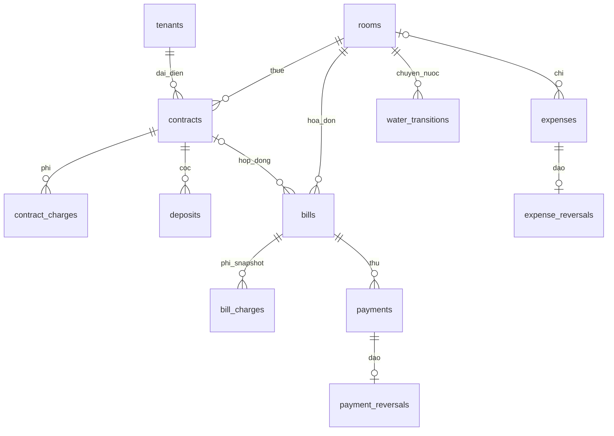

# Kiến trúc NhaTroHomu

Java 21, một tiến trình dùng một sổ local. Giao diện chạy trên Swing EDT; đọc OCR, báo cáo và tác vụ dài dùng worker nền. Công thức dùng BigDecimal; SQLite giữ snapshot và lịch sử.

## Package

```text
vn.nhatrohomu
├── app                  Main, AppWindow, profile, dữ liệu demo
├── billing              công thức điện nước
│   └── ui               nhập ảnh/chỉ số và thu tiền
├── room.ui              phòng và chuyển cách tính nước
├── rental               hợp đồng, tiền phòng, interface nghiệp vụ
│   └── ui               người thuê, hợp đồng, cọc, công nợ
├── reporting            báo cáo, sổ chi và giao diện đối soát
├── persistence          interface lưu trữ
│   └── sqlite           JDBC, transaction, schema, validator, audit
├── integration          OCR Windows, ảnh, PDF
└── shared               model, validation, theme, thành phần UI, CSV
```

`DataRules` là kiểm tra dữ liệu thuần Java. Repository kiểm tra lại dữ liệu và trạng thái hiện hành trong transaction, vì dữ liệu từ form có thể cũ. `DatabaseAccess` cung cấp một cơ chế connection và khóa vòng đời chung; phục hồi giữ khóa độc quyền để chờ các tác vụ đang dùng DB.

Các store hiện vẫn kết hợp SQL và một số quy tắc ghi nghiệp vụ. Đây là ứng dụng desktop được chia theo chức năng, chưa phải kiến trúc backend hay hệ thống nhiều module độc lập.

## Schema 4 đang chạy

| Bảng | Trường/quan hệ chính |
|---|---|
| rooms | name unique, chỉ số ban đầu, mode/mức khoán, active |
| rates | singleton đơn giá hiện hành và mức nước mặc định |
| tenants | tên, liên hệ, ghi chú, active |
| contracts | FK phòng/người, ngày, tiền thuê/cọc, hạn thu, closed_date, cancelled_at/reason |
| contract_charges | FK hợp đồng, tên và tiền phí |
| deposits | FK hợp đồng, loại RECEIVE/REFUND, tiền, ngày và ghi chú |
| bills | FK phòng/hợp đồng; kỳ, tên/giá/chỉ số/phí snapshot, ảnh, tổng, paid cache, created_at, voided_at/reason |
| bill_charges | FK hóa đơn, phí snapshot |
| payments | FK hóa đơn, tiền/ngày/note, created_at, request_key unique |
| payment_reversals | FK lần thu unique, thời điểm đảo, lý do |
| water_transitions | FK phòng, kỳ hiệu lực unique theo phòng, mode cũ/mới, số bàn giao, mức khoán, lý do |
| audit_events | thời điểm, thao tác, loại/mã đối tượng và chi tiết |
| expenses | FK phòng nullable, tên phòng snapshot, loại/người nhận, tiền nguyên INTEGER, ngày, phương thức, note, request_key |
| expense_reversals | FK khoản chi unique, thời điểm đảo, lý do |

**14 bảng**: danh sách này là schema thực tế, không phải danh sách bảng cho các tính năng tương lai. Phần lớn tiền/chỉ số cũ lưu TEXT để đọc bằng BigDecimal; khoản chi mới dùng INTEGER đồng.



`rates` và `audit_events` đứng riêng.

## Bất biến quan trọng

- Chốt tuần tự, kiểm tra nghĩa vụ kỳ đầu và các kỳ thuê thiếu. Số cũ phải khớp số hiện có trong DB ngay trong transaction.
- Lượng dùng/tổng phải khớp chỉ số và giá ở mọi nhánh, kể cả hóa đơn không có hợp đồng.
- Thu không vượt dư nợ. Khóa ghi trước khi đọc số dư; request key tránh ghi hai lần khi retry cùng thao tác.
- Hủy hóa đơn giữ bản gốc/ảnh, không tái sử dụng ID; chỉ hủy kỳ cuối không còn khoản thu hiệu lực và không đi ngược mốc chuyển nước.
- Đảo thu/chi giữ bản gốc, mỗi bản gốc chỉ đảo một lần. Trigger chặn sửa/xóa lịch sử tài chính và audit qua SQL thông thường.
- Hợp đồng nhập nhầm chưa có chứng từ được đánh dấu hủy, giữ ID và điều khoản; không tính vào khoảng thuê/nghĩa vụ.
- Chuyển nước chỉ ở đầu kỳ tiếp theo. Từ đồng hồ sang khoán phải chốt hết kỳ trước; quay lại đồng hồ dùng số bàn giao mới.
- Phục hồi xác thực mọi dòng trước khi thay file live. Hóa đơn đã hủy vẫn phải có tổng và tham chiếu hợp lệ.

## Báo cáo

`ReportStore` đọc các phần trong một transaction, không nạp BLOB ảnh. Phân biệt kỳ phục vụ và ngày giao dịch. Tiền thu/chi có bản gốc và đảo nên báo cáo theo ngày có thể tái dựng điều chỉnh. Công nợ và tuổi nợ hiện là số dư hôm nay, chưa phải báo cáo tại ngày quá khứ.

## Nâng cấp tiếp theo

Điều khoản/giá có hiệu lực, số đo/đồng hồ độc lập, hóa đơn có từng dòng, thu–phân bổ nhiều hóa đơn, giảm trừ/hoàn tiền và quyết toán cọc cần migration mới. Không thêm bảng rỗng rồi coi tính năng đã có; mỗi bảng phải đi cùng luồng UI, transaction, đối soát và kiểm thử.
